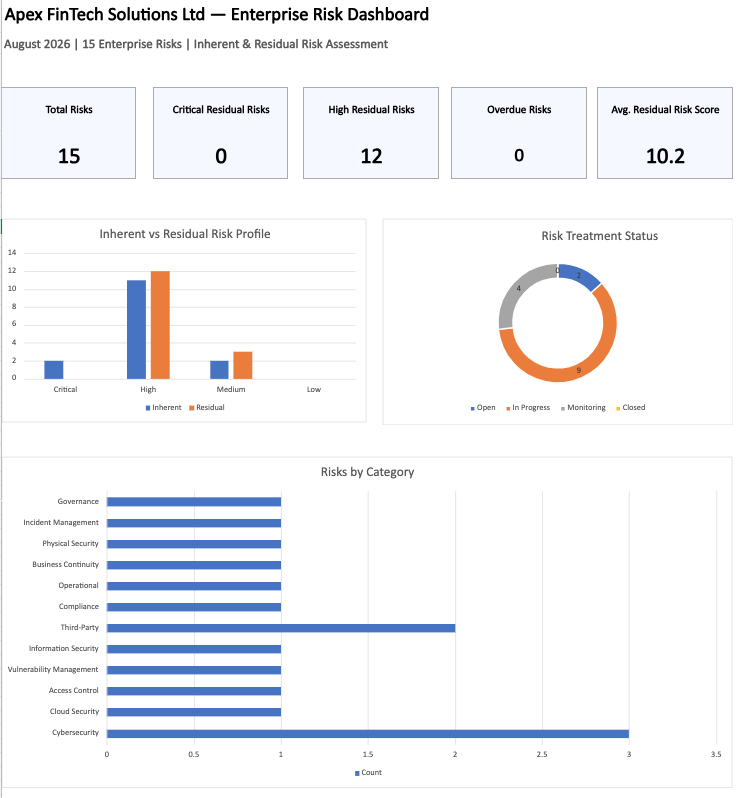

# Enterprise Risk Assessment & Risk Register

## Project Overview

This project demonstrates the development of an enterprise risk assessment and reporting framework for **Apex FinTech Solutions Ltd**, a fictional UK financial technology company.

The objective was to identify key business and information security risks, assess inherent and residual exposure, evaluate existing controls, define risk treatment actions, and present the organisation's risk profile through an executive dashboard.

> **Disclaimer:** Apex FinTech Solutions Ltd is a fictional organisation created solely for this portfolio case study. All risks, controls, assessments and data are simulated for demonstration purposes.

---

## Business Scenario

Apex FinTech Solutions Ltd operates cloud-based financial services and processes customer, financial and employee information.

The organisation relies on Microsoft 365, cloud infrastructure, third-party service providers and other technology platforms to support its operations.

The assessment considers risks across areas including cybersecurity, cloud security, third-party risk, privacy and compliance, business continuity, access control and operational resilience.

---

## Risk Assessment Approach

A 5×5 risk assessment methodology was used.

**Risk Score = Likelihood × Impact**

Risks were assessed at two stages:

- **Inherent Risk** — exposure before considering existing controls.
- **Residual Risk** — remaining exposure after considering existing controls.

Risk scores were classified as:

| Score | Rating |
|---|---|
| 1–4 | Low |
| 5–9 | Medium |
| 10–16 | High |
| 17–25 | Critical |

Existing controls were reviewed and further treatment actions were documented for risks requiring additional management.

---

## Key Deliverables

The project includes:

- Enterprise Risk Register covering 15 identified risks
- Inherent and residual risk assessments
- Existing control documentation
- Risk ownership and treatment plans
- 5×5 Risk Matrix
- Documented Risk Assessment Methodology
- Dynamic risk calculations and ratings
- Executive Risk Dashboard
- Risk treatment status monitoring
- Risk categorisation and reporting

---

## Key Risk Insights

The assessment identified:

- **15 enterprise risks**
- **2 Critical inherent risks**
- **11 High inherent risks**
- **2 Medium inherent risks**
- **0 Critical residual risks**
- **12 High residual risks**
- **3 Medium residual risks**

The results indicate that existing controls reduce the organisation's most severe exposures, with no risks remaining Critical after control consideration. However, significant High residual exposure remains and requires continued treatment and monitoring.

---

## Dashboard

The executive dashboard provides management-level visibility of:

- Total identified risks
- Critical and High residual exposure
- Average residual risk score
- Overdue risk treatments
- Inherent versus residual risk profile
- Risk treatment status
- Risks by category

---

## Tools Used

- Microsoft Excel
- Microsoft 365
- Visual Studio Code
- Git
- GitHub

---

## Skills Demonstrated

Risk Assessment • Enterprise Risk Management • Risk Registers • Inherent & Residual Risk • Control Assessment • Risk Treatment • Risk Reporting • GRC • Information Security Risk • Third-Party Risk • GDPR • Business Continuity • Executive Reporting • Microsoft Excel

---

## Portfolio Note

This project was developed as a practical GRC portfolio case study using a simulated business environment. It is intended to demonstrate risk analysis, documentation, reporting and governance capabilities rather than represent work completed for a real organisation.