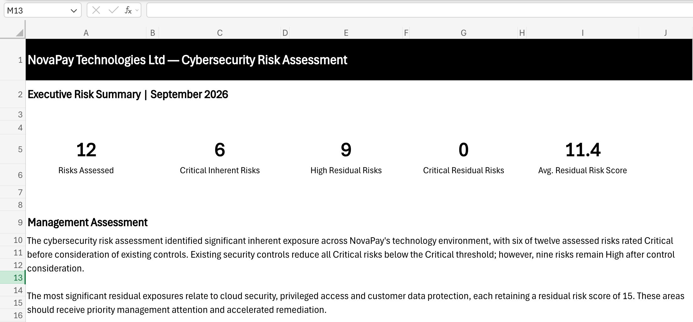
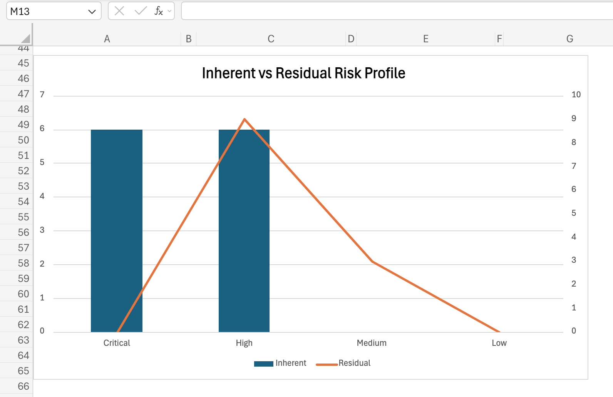
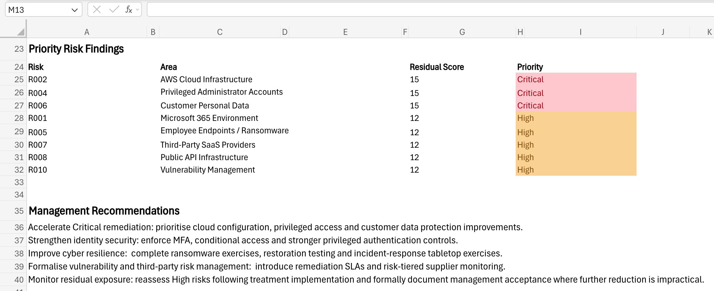

# Cybersecurity Risk Assessment & Treatment Plan

## Project Overview

This project demonstrates a structured cybersecurity risk assessment for **NovaPay Technologies Ltd**, a fictional UK financial technology company providing cloud-based payment services.

The assessment was conducted to identify cybersecurity risks across NovaPay's technology environment, evaluate existing security controls, determine inherent and residual risk exposure, and develop prioritised treatment actions for management.

> **Disclaimer:** NovaPay Technologies Ltd is a fictional organisation created solely for this portfolio case study. All risks, controls, findings and assessment data are simulated for demonstration purposes.

---

## Business Scenario

NovaPay has experienced rapid growth and increased reliance on cloud infrastructure, SaaS providers, APIs, remote working technologies and digital payment services.

Management requested a cybersecurity risk assessment to understand the organisation's current exposure and determine where additional controls and remediation activities should be prioritised.

The assessment considered assets and processes including:

- Microsoft 365
- AWS cloud infrastructure
- Customer payment systems
- Privileged administrator accounts
- Employee endpoints
- Customer personal data
- Third-party SaaS providers
- Public APIs
- Backup and recovery
- Server and application infrastructure
- Remote working
- Security incident response

---

## Assessment Methodology

A **5×5 likelihood and impact methodology** was used.

**Risk Score = Likelihood × Impact**

Each risk was evaluated at two stages:

- **Inherent Risk** — exposure before considering existing controls.
- **Residual Risk** — remaining exposure after existing controls were considered.

| Score | Rating |
|---|---|
| 1–4 | Low |
| 5–9 | Medium |
| 10–16 | High |
| 17–25 | Critical |

Existing controls were assessed for effectiveness, and additional treatment actions were defined where residual exposure remained above acceptable levels.

---

## Risk Assessment Process

The assessment followed a structured process:

**Asset / Process → Threat → Vulnerability → Risk Scenario → Inherent Risk → Existing Controls → Residual Risk → Treatment**

This approach connects each risk to a specific business or technology context rather than assessing risks as isolated generic statements.

---

## Key Findings

The assessment identified **12 cybersecurity risks**.

### Inherent Risk Profile

- **6 Critical**
- **6 High**
- **0 Medium**
- **0 Low**

### Residual Risk Profile

- **0 Critical**
- **9 High**
- **3 Medium**
- **0 Low**

Existing controls reduced all Critical inherent risks below the Critical threshold.

However, **nine of the twelve assessed risks remain High after control consideration**, indicating significant residual exposure requiring continued remediation and monitoring.

---

## Executive Risk Overview

The executive summary provides management with a concise view of the assessment results, including total risks assessed, Critical inherent exposure, High residual exposure and average residual risk.

---

## Risk Profile Analysis

The risk profile demonstrates the effect of existing controls on the organisation's cybersecurity exposure.

While the controls eliminate Critical residual ratings, they do not eliminate significant risk. Several exposures move from Critical to High rather than reaching an acceptable lower level, highlighting the need for further treatment.

---

## Priority Risk Findings

The highest residual risk scores were associated with:

- **AWS Cloud Infrastructure — 15**
- **Privileged Administrator Accounts — 15**
- **Customer Personal Data — 15**

These areas were assigned Critical remediation priority despite having High residual risk ratings because of their potential security, operational and regulatory consequences.

Additional High residual exposures were identified across Microsoft 365, ransomware resilience, third-party SaaS services, public APIs, backup and recovery, and vulnerability management.

---

## Risk Treatment Strategy

Treatment actions were developed according to the nature and severity of each risk.

Key actions included:

- Expanding MFA and strengthening conditional access
- Implementing privileged access management
- Introducing automated cloud configuration monitoring
- Strengthening data loss prevention and access recertification
- Deploying endpoint detection and response controls
- Establishing risk-based vulnerability remediation SLAs
- Introducing risk-tiered supplier assessments
- Strengthening API security monitoring and testing
- Performing regular backup restoration tests
- Conducting incident response tabletop exercises

Each treatment action was assigned an owner, priority, target date, status and implementation progress.

---

## Management Recommendations

Management should prioritise remediation of cloud security, privileged access and customer data protection risks.

Identity controls should be strengthened through broader MFA enforcement, conditional access and enhanced privileged authentication.

Cyber resilience should be improved through ransomware exercises, backup restoration testing and incident response simulations.

Vulnerability management and third-party risk processes should be formalised through defined remediation SLAs and risk-tiered supplier monitoring.

High residual risks should be reassessed following treatment implementation, with any formally accepted residual exposure documented through appropriate governance processes.

---

## Project Deliverables

This project includes:

- Cybersecurity Risk Assessment
- 12 detailed risk scenarios
- Inherent and residual risk analysis
- Control effectiveness assessment
- Risk Treatment Plan
- Remediation tracking
- 5×5 Risk Matrix
- Executive Risk Summary
- Dynamic risk profile reporting
- Management recommendations

---

## Tools Used

- Microsoft Excel
- Microsoft 365
- Visual Studio Code
- Git
- GitHub

---

## Skills Demonstrated

Cybersecurity Risk Assessment • Risk Analysis • Threat & Vulnerability Assessment • Inherent & Residual Risk • Control Effectiveness • Risk Treatment • Remediation Planning • Risk Prioritisation • Executive Reporting • GRC • Cloud Risk • Third-Party Risk • Identity & Access Risk • Operational Resilience

---

## Portfolio Disclaimer

This project was developed using a fictional business environment and simulated assessment data. It is intended to demonstrate practical GRC and cybersecurity risk assessment capability and does not contain confidential information from a real organisation.