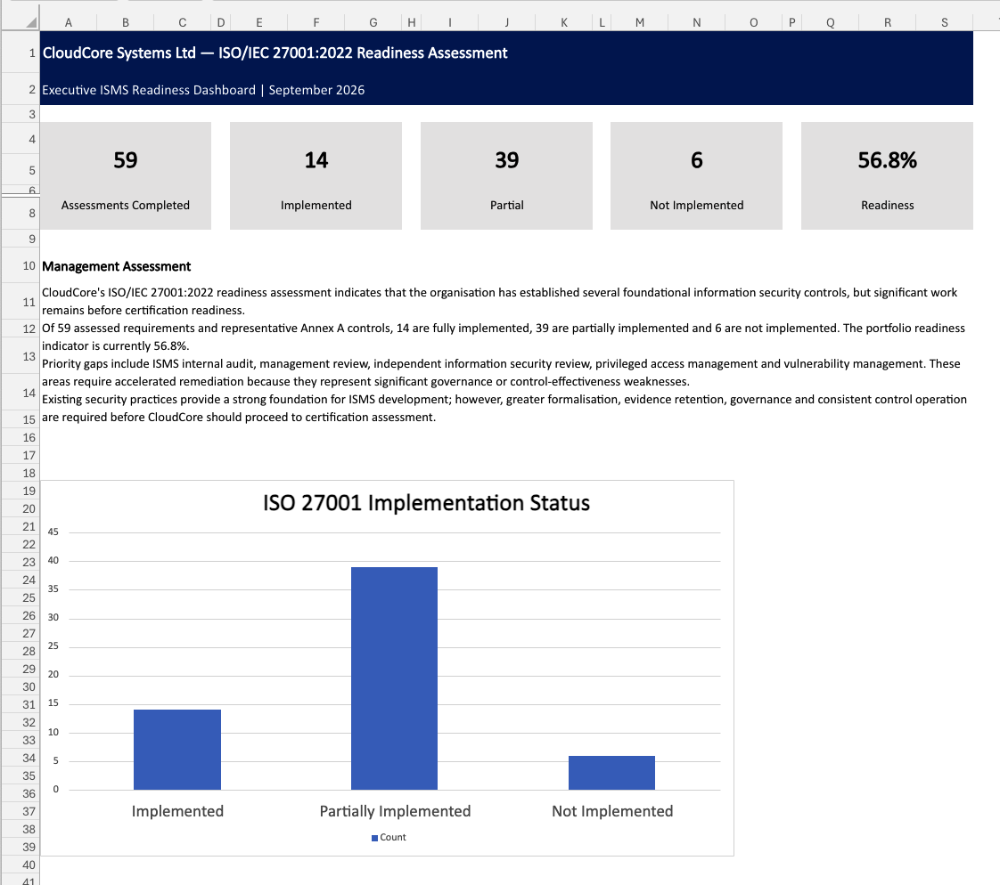
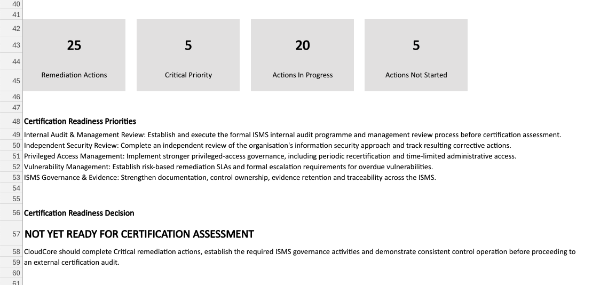
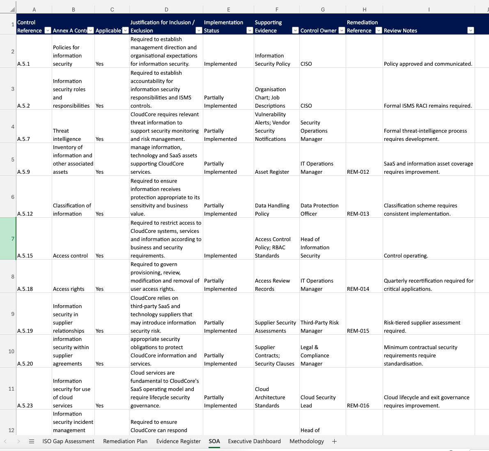

# ISO/IEC 27001:2022 Gap Assessment & Remediation Plan

## Project Overview

This project demonstrates an ISO/IEC 27001:2022 information security management system (ISMS) gap assessment for **CloudCore Systems Ltd**, a fictional cloud-based technology company.

The objective was to assess selected ISMS requirements and Annex A controls, identify implementation gaps, establish remediation actions, organise supporting evidence and present management with a structured view of readiness.

> **Disclaimer:** CloudCore Systems Ltd is fictional. All assessment results, control statuses, evidence records and remediation activities are simulated for portfolio demonstration purposes.

## Business Scenario

CloudCore relies on cloud infrastructure, SaaS services, remote working and software development. Management needs a clearer understanding of its ISMS maturity, outstanding security gaps, evidence requirements and priorities before considering an external certification audit.

The assessment focuses on governance, risk management, access control, supplier security, cloud security, operational controls, audit and continual improvement.

## Assessment Methodology

The workbook uses a structured assessment of implementation status:

| Status | Score |
|---|---:|
| Implemented | 1.0 |
| Partially Implemented | 0.5 |
| Not Implemented | 0 |
| Not Applicable | Excluded |

The readiness percentage is an **internal portfolio indicator**, calculated from the assessment scores. It is not an official ISO certification score and does not independently establish conformity or certification readiness.

## Key Findings

The assessment covers **59 requirements and representative Annex A control assessments**.

- **14** fully implemented
- **39** partially implemented
- **6** not implemented
- **56.8%** internal readiness indicator

The findings indicate that foundational security practices exist, but further formalisation, evidence retention, governance and consistent control operation are required.

Priority improvement areas include the ISMS internal audit programme, management review, independent information security review, privileged access management and vulnerability remediation.

## Executive Readiness Dashboard

The dashboard summarises implementation status, the internal readiness indicator and management's assessment of the principal gaps.

## Remediation Planning

The remediation tracker contains **25 actions**, including **5 Critical-priority actions**. Each action includes an identified owner, target date, status, progress indicator, required evidence and management notes.

The plan prioritises governance and assurance activities alongside technical improvements, including privileged access, vulnerability management, cloud configuration, supplier security and recovery testing.

## Statement of Applicability

The workbook includes a **representative Statement of Applicability (SoA) extract containing 36 selected Annex A controls**. Each record documents applicability, justification, implementation status, supporting evidence, ownership and relevant remediation references where applicable.

This is a selected portfolio extract, not a complete SoA covering all 93 Annex A controls. In an operational ISMS, the SoA must be determined from the organisation's risk treatment process, with applicable controls justified and exclusions documented.

## Evidence Register

The evidence register contains 36 records covering governance documents, policies, audit records, technical evidence, access reviews, supplier assessments and business continuity records. It tracks document ownership, review frequency, status, storage location and notes.

The register demonstrates how evidence can be linked to assessment findings and remediation activities.

## Project Deliverables

- ISO/IEC 27001:2022 gap assessment
- Implementation status and readiness scoring
- Remediation plan with ownership and progress tracking
- Representative Statement of Applicability
- Evidence register
- Executive readiness dashboard
- Assessment methodology and management recommendations

## Tools and Skills Demonstrated

**Tools:** Microsoft Excel, Microsoft 365, Visual Studio Code, Git and GitHub.

**Skills:** ISO 27001 gap assessment, ISMS governance, control assessment, remediation planning, evidence management, Statement of Applicability, risk-based prioritisation, audit readiness, management reporting and GRC documentation.

## Portfolio Disclaimer

This project is a simulated learning and portfolio exercise. It does not represent an actual certification assessment, independent audit or assurance opinion, and it does not claim that CloudCore is ISO/IEC 27001 certified.
